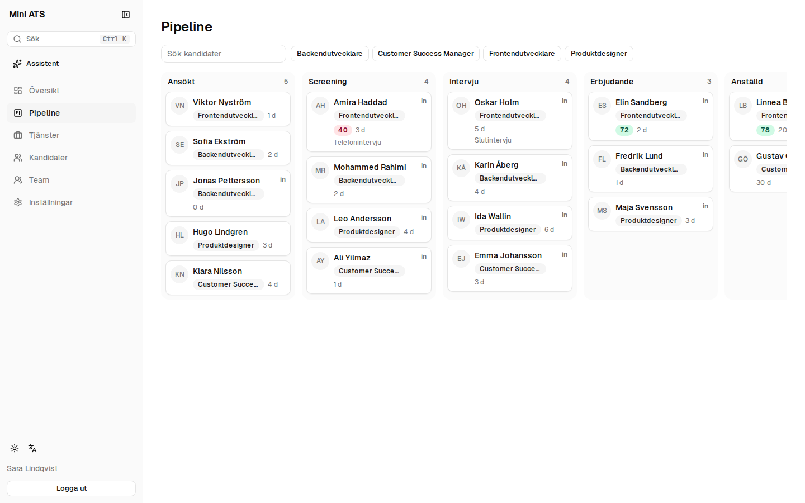
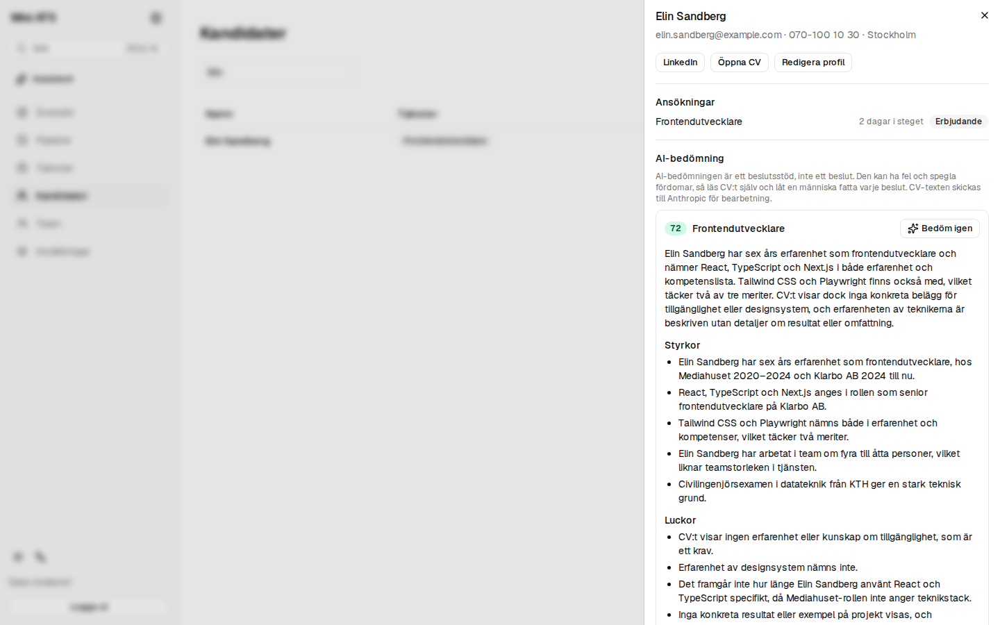
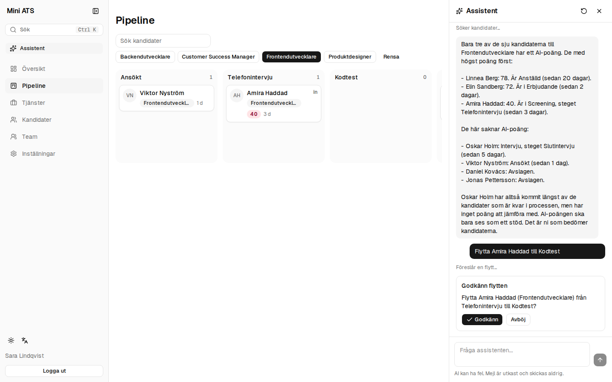
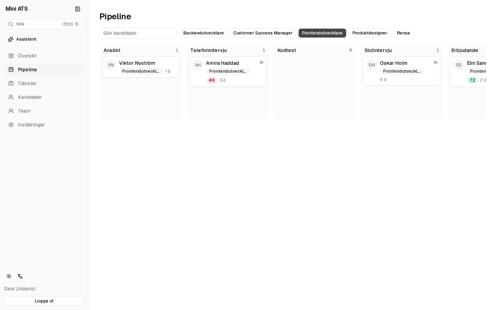
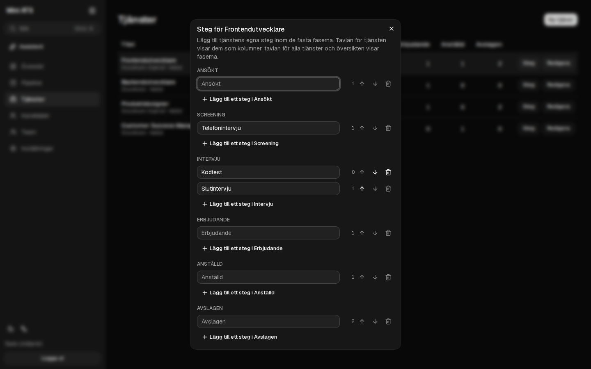
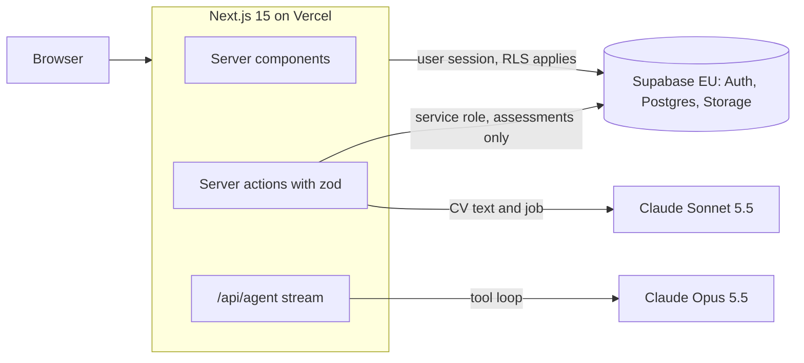

<div align="center">

# ATS: Mini Applicant Tracking System

**A fast, modern applicant tracking system, built to be in the hands of a first customer as quickly as possible.**

[](https://nextjs.org)
[](https://www.typescriptlang.org)
[](https://supabase.com)
[](https://tailwindcss.com)
[](https://www.anthropic.com)
[](https://vercel.com)

**Live:** [ats.t4ngo.com](https://ats.t4ngo.com) · **Plan:** [PLAN.md](./PLAN.md) · **Reviews:** [REVIEW.md](./REVIEW.md)

</div>



## What it does

Mini ATS is a recruiting tool for small and medium sized companies. An internal admin sets up each customer company and its users; the customer's recruiters post jobs, add candidates and move them through a kanban pipeline. Everything is in Swedish by default, with English one click away.

### The brief: seven user stories

| # | As a | I can | Where |
|:--|:-----|:------|:------|
| 1 | **Admin** | create accounts, both admin and customer accounts | Admin, Users: email, role, organization and a generated temporary password |
| 2 | **Customer** | log in | Email and password, password reset by email, change password in Settings |
| 3 | **Customer** | post jobs I'm recruiting for | Jobs: title, description, location, employment type, open, paused or closed |
| 4 | **Customer** | add candidates with profile information | Candidates: contact details, LinkedIn link, notes, a CV as PDF, one or more jobs |
| 5 | **Customer** | see a compact kanban view of all my candidates | Pipeline: drag and drop with mouse or keyboard, days in stage, AI score |
| 6 | **Customer** | filter the kanban view by job and candidate name | Pipeline: job chips and a name search, kept in the URL so a view can be shared |
| 7 | **Admin** | do everything customers can do, on their behalf | An organization switcher with a "Viewing as" banner; no impersonation, so every change is logged as the admin |

All seven are live, covered by end to end tests and backed by row level security tested per policy.

### Beyond the brief

**AI CV assessment.** One click scores a candidate's CV against a job from 0 to 100, with a summary, strengths, gaps, a match per requirement with evidence, and suggested interview questions. It is never automatic, it states clearly that it is decision support, and the prompt keeps protected traits out of the judgement. A consistency eval runs each sample CV several times: the spread stays within 6 points and the ranking holds.



**Recruiter assistant.** A chat panel next to the board answers questions about the pipeline, finds candidates, drafts emails and proposes moves. It works through server side tools that run as the signed in user, so it sees exactly what the user may see, and a move only happens after the user approves it.



**Custom stages per job.** Each job can have its own stages, such as a phone screen, a coding test or a final interview, inside six fixed phases. A job's board shows its own columns, while the all jobs board, the dashboard and the assistant keep the common phases.

| Board for one job | Stage editor (dark mode) |
|:---|:---|
|  |  |

**Polish.** Swedish and English, dark, light and system theme, a collapsible sidebar, a command palette (Ctrl K) over pages, candidates and jobs, keyboard drag and drop, skeleton loading states, error and 404 pages, and a responsive layout down to phone width.

## Architecture



**Data model.** `organizations` (the customers), `profiles` (users, with role and organization), `jobs`, `job_stages`, `candidates`, `applications` (a candidate in a job, with stage and position), `cv_assessments`, `activity_log` and a private `cvs` storage bucket. Composite foreign keys make sure a row can only point at rows of its own organization, and a CV path must sit in its own candidate's folder.

**Security.**

* Row level security on every table, with a pytest test for each policy (about a hundred cases in `tests/rls/`).
* Every query goes through one scope helper (`src/lib/data/scope.ts`) that pins it to the active organization. That is what makes "act as customer" safe for admins, who can see every organization through RLS.
* The service role key is server only. It creates accounts, writes AI assessments (users can read but never write a score) and claims the lock that stops two assessments of the same candidate from running at once.
* Server actions validate every input with zod; deactivated users are blocked in the database as well as in the app.

**AI.**

* CV assessment: the server extracts the PDF text, sends it with the job description to Claude Sonnet 5.5 with structured output, and stores every run. The prompt lives in `src/lib/ai/assessment-prompt.json`, shared with the Python eval so the two cannot drift. CV text is treated as data, not instructions.
* Assistant: Claude Opus 5.5 in a streaming tool loop (`src/lib/agent/`) with five tools. Moves pause the loop for the user's approval and resume in the next request. The conversation is kept in the browser and checked on the server for shape and size.
* Both use Anthropic's server side refusal fallback, and both have a fake mode (`AI_FAKE=1`) so CI tests the full flow without calling the API.

## Quality

| Check | What it covers |
|:------|:---------------|
| ESLint, TypeScript, Prettier | the whole codebase |
| Vitest | prompt building and conversation history handling |
| pytest (`tests/rls/`) | every RLS policy, the stage triggers, the assessment locks |
| Playwright (`e2e/`) | the full v1 flow from admin to customer, auth, CV assessment, the assistant, custom stages |
| `scripts/eval_assessment.py` | AI score consistency on sample CVs |

GitHub Actions runs everything except the paid eval on every pull request. Each phase was reviewed before merging; the findings and fixes are logged in [REVIEW.md](./REVIEW.md). The plan and the decisions behind it are in [PLAN.md](./PLAN.md).

## Getting started

Requirements: Node.js 24, pnpm 11, Python 3.14 and Docker (for the local Supabase stack).

```bash
git clone https://github.com/GHT4ngo/ATS.git
cd ATS
pnpm install
python3 -m venv .venv && .venv/bin/pip install -r requirements-dev.txt
pnpm exec supabase start          # local Postgres, Auth and Storage in Docker
cp .env.example .env.local        # fill in the values from `pnpm exec supabase status`
pnpm dev                          # http://localhost:3000
```

Demo data (a fictional Stockholm company with 4 jobs and 20 candidates with CVs):

```bash
SEED_PASSWORD=choose-one .venv/bin/python scripts/seed.py         # local
SEED_PASSWORD=choose-one .venv/bin/python scripts/seed.py --prod  # the project in .env.local, asks first
```

AI CV assessment needs `ANTHROPIC_API_KEY` in `.env.local`. Without a key, set `AI_FAKE=1` for a fixed test result.

### Tests

```bash
pnpm lint && pnpm typecheck && pnpm test     # ESLint, TypeScript, Vitest
.venv/bin/pytest                             # RLS policies against the local Supabase
pnpm e2e                                     # Playwright, starts its own dev server on port 3100
.venv/bin/python scripts/eval_assessment.py  # AI score consistency, calls the API (about 0.20 USD)
```

GitHub Actions runs everything except the eval on every pull request.

## The assignment

<details>
<summary><b>The brief, guidelines and deliverables</b></summary>

<br>

Build a **mini ATS (applicant tracking system)** that can be live with a first customer as quickly as possible. The seven core user stories are listed above.

**Guidelines**

* **Supabase** as the backend (authentication and database)
* Build as much as possible **with AI tools** to move fast; this project was built with Claude Code
* Free to make assumptions about customers, wishes and needs
* Free to add further functionality that fits an ATS if time allows

**Extra task: AI feature**

* Implement a simple, stripped down **AI powered assessment of a candidate's CV**
* At minimum, explain in the demo how such a problem would be approached

**Deliverables**

* Admin login to the platform
* A 5 minute demo video
* An email describing the assumptions made
* A link to this repository

</details>

<details>
<summary><b>Originaluppgiften (svenska)</b></summary>

<br>

Bygg ett mini ATS (applicant tracking system) som kan vara live i händerna på en första kund så snabbt som möjligt.

**Core features**

* Som admin kan jag skapa konton (både admin konton och kund konton)
* Som kund kan jag logga in
* Som kund kan jag lägga upp jobb jag söker kandidater till
* Som kund kan jag lägga till kandidater med dess profilinformation (t.ex. Linkedin länk)
* Som kund kan jag se en kompakt kanban vy med alla kandidater tillhörande
* Som kund kan jag filtrera kanban vyn på jobb och kandidatnamn
* Som admin kan jag göra allt som kunder kan göra åt dem

**Guidelines**

* Använd Supabase som backend (tex authentication och databas)
* Utveckla så mycket som möjligt mha av AI verktyg för att kunna bygga så snabbt som möjligt (t.ex. Lovable, Cursor, Claude Code, Codex, Copilot)
* Känn dig fri att göra valfria antaganden kring kunder, önskemål, behov, osv.
* Känn dig fri att bygga ut ytterligare funktionalitet du anser vara lämplig i ett ATS om du har tid över

**Leverans**

* Dela admin login till plattformen med mig
* Spela in en 5 min demo video mha Loom eller liknande verktyg och dela med mig
* Dela eventuella antaganden du gjort i ett mejl till mig
* Dela länk till repot
* Känn dig fri att shippa ofta (dvs du kan leverera flera gånger om du vill)

**Extra uppgift (AI feature)**

* Implementera en enkel, avskalad funktion för bedömning av kandidatens CV med hjälp av AI
* Åtminstone: berätta i demon hur du hade angripit ett sådant problem

**Deadline:** 1 vecka, alltså fredag 30 oktober.

</details>

<div align="center">
<sub>Built with the help of <a href="https://claude.com/claude-code">Claude Code</a></sub>
</div>
